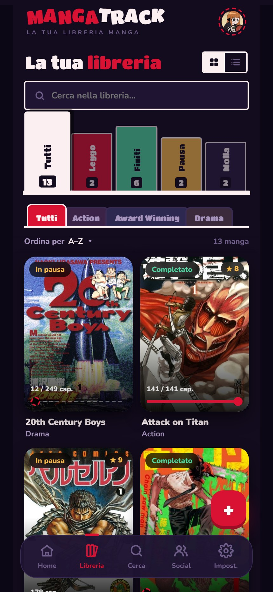
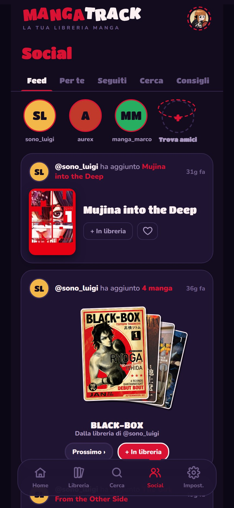
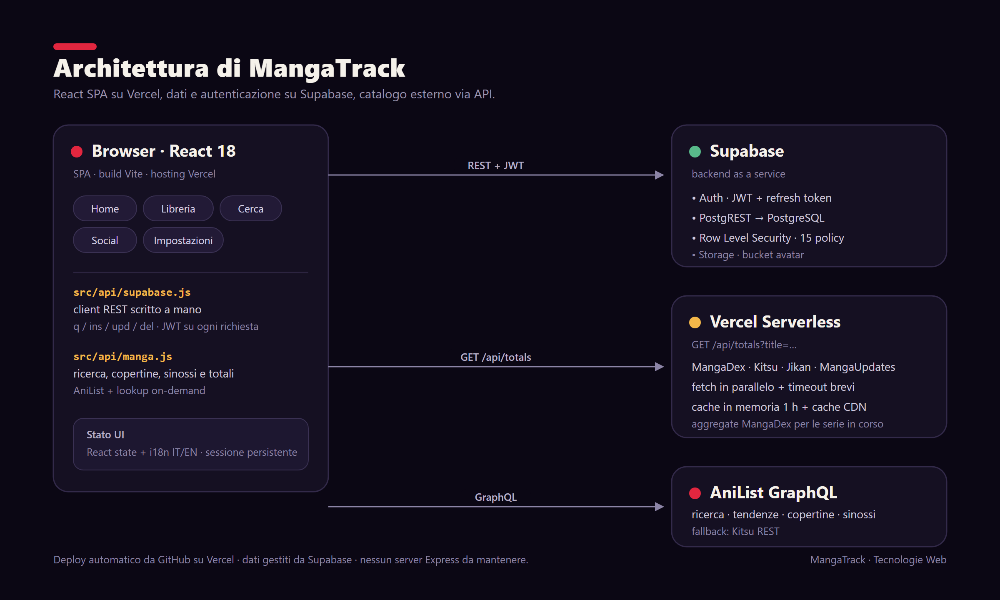

# MangaTrack

Web app per tenere traccia della propria libreria manga: cosa sto leggendo, a che capitolo sono arrivato, cosa ho finito e cosa leggono gli amici.

Progetto individuale (tesina) per il modulo di **Tecnologie Web**, AA 2026-27, UNIMORE.
Autore: **Behar Myzyri**

[](https://github.com/behardo/MangaTrack-IOS-Android/actions/workflows/ci.yml)

## Demo

- **App online:** https://manga-track-ios.vercel.app
- **Presentazione:** [`docs/MangaTrack_Behar_Myzyri.pdf`](docs/MangaTrack_Behar_Myzyri.pdf) (versione PowerPoint con demo video: [`docs/MangaTrack_Behar_Myzyri.pptx`](docs/MangaTrack_Behar_Myzyri.pptx))
- **Scaletta della demo:** [`docs/DEMO.md`](docs/DEMO.md)

| Home | Libreria | Social |
|---|---|---|
|  |  |  |

---

## 1. Problema e obiettivo

Chi legge manga li segue spesso su siti, app e formati diversi: volumi cartacei, capitoli settimanali e scan online. Il risultato è che si perde il punto in cui si era arrivati, non si sa quanti capitoli mancano e i consigli degli amici finiscono sparsi nelle chat.

**Obiettivo:** un unico posto, accessibile dal browser (anche da telefono), in cui:

- cercare un manga in un catalogo esterno e aggiungerlo alla propria libreria;
- aggiornare lo stato di lettura (in lettura, completato, in pausa, abbandonato, da leggere) e il capitolo o volume raggiunto;
- vedere i progressi e l'attività recente;
- seguire altri utenti e consigliare loro dei titoli.

### Requisiti funzionali principali

| Area | Funzionalità |
|---|---|
| Account | Registrazione, login, sessione persistente con refresh del token, logout, eliminazione account |
| Libreria | Aggiunta (C), lista e dettaglio (R), aggiornamento di stato, capitoli e volumi (U), rimozione (D) |
| Catalogo | Ricerca e titoli di tendenza da API esterne, totale di capitoli e volumi |
| Social | Follow e unfollow, consigli ad altri utenti (invio ed eliminazione), feed attività |
| Profilo | Nome, bio e avatar (upload su Storage), lingua IT/EN |

### Viste principali

`AuthView` (accesso), `HomeView` (riepilogo e tendenze), `LibraryView` (libreria), `SearchView` (ricerca), `SocialView` (amici e consigli), `SettingsView` (profilo e lingua), più `DetailView` e le modali `PreviewSheet`, `RecommendModal` e `DeleteModal`.

---

## 2. Architettura



### Backend

Il backend è composto da due parti.

1. **Supabase** gestisce dati, autenticazione e file:
   - **PostgreSQL** con 5 tabelle relazionali (`profiles`, `library`, `activity`, `follows`, `recommendations`);
   - **PostgREST** espone le tabelle come API REST (`GET`, `POST`, `PATCH`, `DELETE`);
   - le **policy Row Level Security** fanno rispettare le regole di accesso nel database: il JWT dell'utente identifica chi fa la richiesta (`auth.uid()`) e ognuno può inserire, modificare o eliminare solo le righe che gli appartengono;
   - **Auth** rilascia i JWT, che il client invia in ogni richiesta;
   - **Storage** conserva gli avatar nel bucket `avatars`.
2. **Funzione serverless Vercel** `api/totals.js` (`GET /api/totals?title=...`): interroga in parallelo MangaDex, Kitsu e Jikan con timeout brevi (1,2–2,5 s) per non bloccare l'attesa, tiene il totale più alto di capitoli e volumi, valida l'input (400 o 405) e mette in cache il risultato (in memoria e con `s-maxage` sulla CDN). Per le serie in corso, per cui MangaDex lascia vuoti `lastChapter`/`lastVolume`, ricava i totali dall'endpoint `aggregate` dello stesso manga. Integra anche **MangaUpdates**: per le serie in corso usa il conteggio capitoli più aggiornato e per i titoli sconosciuti alle altre fonti ne legge `latest_chapter` e i volumi dallo `status`; i volumi di MangaUpdates non sovrascrivono quelli già noti. In questo modo il browser fa una sola richiesta invece di tre e la logica di aggregazione sta in un punto solo. Se la funzione non risponde, per esempio con `npm run dev`, il client ripiega sulle chiamate dirette.

### Modello dei dati

| Tabella | Contenuto | Relazioni |
|---|---|---|
| `profiles` | username, bio, avatar_url, avatar_color | `id` = utente di Supabase Auth |
| `library` | title, cover, genre, status, chapters / total_chapters, volumes / total_volumes, score, favourite, review | `user_id` → profiles |
| `activity` | type, manga_title, manga_cover, details | `user_id` → profiles |
| `follows` | chi segue chi | `follower_id`, `following_id` → profiles |
| `recommendations` | titolo consigliato con messaggio | `from_id`, `to_id` → profiles |

### Struttura del codice

```
api/totals.js            funzione serverless (Vercel)
src/api/supabase.js      client REST scritto a mano: q / ins / upd / del
src/api/library.js       CRUD della libreria + log attività
src/api/social.js        follow e consigli
src/api/storage.js       upload avatar e aggiornamento profilo
src/api/manga.js         AniList / Kitsu / totali
src/context/AuthContext.jsx  sessione, refresh token, eliminazione account
src/i18n/                traduzione IT/EN a runtime
src/components/views/    le viste dell'app
src/components/modals/   finestre modali
tests/                   test con il runner nativo di Node (manga.js, api/totals.js)
```

---

## 3. Stack e motivazione delle scelte

| Scelta | Motivazione | Trade-off accettato |
|---|---|---|
| **React 18 + Vite 5** | Interfaccia a componenti con stato condiviso. Vite offre hot reload rapido e build ottimizzata. | Richiede uno step di build. |
| **Nessun router** (navigazione a schede con stato) | L'app è una shell mobile a schede: con uno stato `view` in `App.jsx` non serve una libreria in più. | Le viste non hanno un URL proprio e non si può condividere un link a una schermata. |
| **Supabase invece di Flask o Express** | PostgreSQL vero, autenticazione con JWT e Storage già pronti e gratuiti. Il tempo è andato su modello dei dati, policy RLS e integrazioni invece che su un server CRUD ripetitivo. | Le regole di business stanno nelle policy RLS e nel client più che in un server scritto a mano. Per la logica che non deve stare nel browser c'è la funzione serverless `api/totals.js`. |
| **Client REST scritto a mano** invece dell'SDK `@supabase/supabase-js` | Circa 60 righe di `fetch` per vedere e controllare ogni richiesta HTTP (header `apikey` e `Authorization`, filtri PostgREST). Le dipendenze di runtime restano due: `react` e `react-dom`. | Funzioni come il realtime vanno implementate a parte. |
| **AniList, con fallback su Kitsu** | AniList ha un'API GraphQL ricca e gratuita. Kitsu fa da riserva quando AniList non risponde (timeout di 6 s e 3 tentativi). | Dipendenza da servizi esterni con limiti di frequenza. |
| **Aggiunta ottimistica** | Il manga compare subito in libreria; i totali arrivano dopo, in background. | In caso di errore va annullata l'aggiunta lato UI. |
| **i18n con dizionario e `MutationObserver`** | Traduzione IT/EN di tutta l'interfaccia senza riscrivere i componenti; la lingua è salvata in `localStorage` (`mt-lang`). | Ogni nuova stringa va aggiunta al dizionario. |
| **Vercel** | Deploy automatico da GitHub, hosting statico e funzioni serverless nello stesso progetto. | Le variabili `VITE_*` sono fissate al momento della build. |

### Approfondimenti autonomi (non trattati a lezione)

- Integrazione di più **API esterne** (GraphQL AniList, REST Kitsu, MangaDex, Jikan) con timeout tramite `AbortController`, tentativi ripetuti e fallback.
- **Funzione serverless** Vercel con cache e aggregazione di più fonti.
- **Supabase**: PostgREST, policy RLS, Auth con refresh token e Storage, usati tramite REST senza SDK.
- **Internazionalizzazione a runtime** basata su `MutationObserver`.
- Arricchimento on-demand di copertine, sinossi e totali di capitoli/volumi nella scheda di dettaglio e nell'anteprima di ricerca: lookup AniList per titolo quando il dato manca, con fallback aggregato (MangaDex/Kitsu/Jikan e MangaUpdates) e auto-correzione dei totali impossibili (capitoli letti maggiori del totale salvato).
- Pipeline di **deploy** con controllo delle variabili d'ambiente in `vite.config.js` e workflow **GitHub Actions** che esegue test e build a ogni push.

---

## 4. Installazione e avvio

Requisiti: Node.js 18 o superiore e un progetto Supabase con le tabelle descritte sopra e le policy RLS attive.

```bash
git clone https://github.com/behardo/MangaTrack-IOS-Android.git
cd MangaTrack-IOS-Android
npm install
cp .env.example .env      # inserisci VITE_SUPABASE_URL e VITE_SUPABASE_ANON_KEY
npm run dev               # http://localhost:3000
```

| Comando | Cosa fa |
|---|---|
| `npm run dev` | Server di sviluppo (porta 3000). `/api/totals` non è attivo e il client usa le chiamate dirette. |
| `npx vercel dev` | Avvia frontend e funzione serverless insieme, come in produzione. |
| `npm run build` | Build di produzione in `dist/` (si ferma se mancano le variabili Supabase). |
| `npm run preview` | Anteprima della build. |
| `npm test` | Test automatici di `manga.js` e della funzione serverless `api/totals.js` (runner nativo di Node, nessuna dipendenza). |

In sviluppo, `?preview=app` avvia la shell con dati demo senza chiamate reali a Supabase, mentre `&lang=en` forza l'interfaccia in inglese.

Nel client va usata **solo la chiave anon** (pubblica, protetta dalle policy RLS). Il file `.env` è escluso da Git e la chiave `service_role` non va mai inserita nel progetto.

### Deploy su Vercel

1. Importa il repository su Vercel (preset **Vite**). La cartella `api/` viene pubblicata automaticamente come funzione serverless.
2. Build command: `npm run build`. Output directory: `dist`.
3. In **Settings → Environment Variables** aggiungi `VITE_SUPABASE_URL` e `VITE_SUPABASE_ANON_KEY` per Production e Preview, poi rifai il deploy.
4. Su Supabase, in **Authentication → URL Configuration**, imposta come Site URL e Redirect URL il dominio Vercel, così i link di conferma e di recupero password puntano all'app pubblicata.

---

## 5. Limiti noti

- I test automatici (`npm test`) coprono le funzioni di mapping e la funzione serverless; l'interfaccia è verificata a mano.
- Se AniList e Kitsu sono entrambi irraggiungibili, la ricerca non restituisce risultati. Anche la sinossi e i totali di capitoli/volumi nella scheda manga arrivano da AniList (con fallback sulle altre fonti) e richiedono la connessione; se nessuna fonte conosce un titolo molto di nicchia, il totale resta `?`.
- Serve la connessione: la libreria non è disponibile offline. Il file `public/sw.js` non è una cache: rimuove il service worker di una versione precedente dell'app.
- Le viste non hanno un URL proprio, perché non c'è un router.

---

## 6. Progetto di partenza

MangaTrack è la riscrittura in React di una versione precedente dell'app scritta dallo stesso autore, una PWA con service worker di cache. Rispetto a quella versione sono stati aggiunti o rifatti:
architettura a componenti React e Vite, client REST verso Supabase con autenticazione e refresh token, modello relazionale con 5 tabelle e RLS, funzioni social (follow, consigli e attività), fallback AniList → Kitsu, aggregazione dei totali tramite funzione serverless, traduzione IT/EN e deploy su Vercel.

---

## 7. Dichiarazione uso di AI

Si dichiara che per la realizzazione del presente progetto software ci si è avvalsi dell'ausilio dei seguenti strumenti di Intelligenza Artificiale Generativa:

- **OpenCode** (agente di programmazione AI): utilizzato come supporto alla scrittura e al refactoring del codice dei componenti React e del client API, e per individuare e correggere bug.
- **Hark** (assistente AI): utilizzato per scrivere la funzione serverless `api/totals.js`, redigere questo README e preparare la presentazione (struttura delle slide, grafica, video demo).

L'idea dell'applicazione, i requisiti, il modello dei dati, l'architettura del software e la logica di business rimangono interamente frutto dell'elaborazione originale dell'autore.

L'autore dichiara di aver effettuato personalmente la verifica funzionale e di sicurezza del codice generato, assumendosi la piena e personale responsabilità del progetto presentato.
